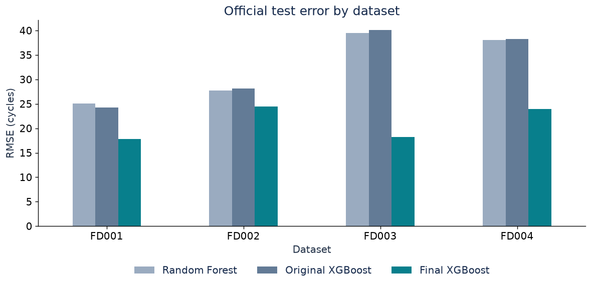

# NASA turbofan predictive maintenance

Predict remaining useful life from sensor histories across all four NASA C-MAPSS
datasets. XGBoost combines operating-regime normalization, causal history features
and a 150-cycle training target cap.

**[Read the presentation notebook](explore.ipynb)** ·
[Downloadable HTML report](presentation.html) ·
[Detailed experiments](experiments.ipynb)



## Results

Evaluated on the same 707 official test engines, using true uncapped RUL labels.
The maintenance event is actual RUL ≤30 cycles.

| Model / alert rule | RMSE (cycles) | Recall | Precision |
| --- | ---: | ---: | ---: |
| Original Random Forest, threshold 30 | 33.14 | 82.4% | 94.2% |
| Original XGBoost, threshold 30 | 33.42 | 81.8% | 94.9% |
| Final XGBoost, threshold 30 | **22.63** | 89.9% | 94.7% |
| Final XGBoost, calibrated threshold 34.44 | **22.63** | **93.7%** | 92.5% |

- **Validation:** engine-separated development CV, a held-out audit, and five
  additional split-sensitivity checks. Normalization is fitted inside each fold.
- **Sensors:** 17 of 21 survive variance filtering. Removing another three did
  not establish a meaningful improvement.
- **Limits:** broad early-life accuracy worsens. Calibrated recall has a 95%
  interval of 88.8–96.5%. The official test was previously observed; this is
  simulation-benchmark evidence, not a deployment or savings claim.

## Sequence model comparison

We also trained small LSTM and TCN models locally on the same development folds.
Primary CV RMSE was **25.93** for XGBoost, **26.43–26.63** for LSTM, and
**26.02–26.19** for TCN across two neural-network seeds. These are development
scores, not the official-test results above. Paired uncertainty intervals include
zero, so the small RMSE gaps are not decisive. The final XGBoost model is unchanged.
See [sequence methods and results](outputs/sequences/METHODS.md) for the bounded
training budget, uncertainty estimates and alert tradeoffs.

The [TCN follow-up](outputs/tcn_followup/METHODS.md) found a stronger development
candidate: **50-cycle histories reached 23.59–24.13 primary CV RMSE** across
three seeds, 7–9% below XGBoost on the same endpoints. Paired intervals favor
TCN for all three seeds. Inner-calibrated alerts achieved **90.8–93.5% recall**
and **90.1–92.2% precision**, with more false alerts. Increasing the budget alone
at 30 cycles did not consistently help. These follow-up development results do
not replace the XGBoost official-test results; TCN still needs independent validation.

## Explore or reproduce

The executed notebooks and HTML are ready to read. Download the HTML and open it
locally for the styled report. The main notebook also runs from the small result
tables included here, without raw data or trained models.

```bash
python3 -m venv nasa
./nasa/bin/python -m pip install -r requirements.txt
./nasa/bin/python scripts/execute_notebook.py
./nasa/bin/python scripts/render_presentation.py
```

[Reproduction instructions](docs/REPRODUCING.md) cover data setup, actual training,
and verification. [baseline.ipynb](baseline.ipynb) preserves the original analysis.
The supporting notebooks need regenerated data/models to execute fully.

## Repository contents

- `scripts/` — training, feature engineering, checks and report generation.
- `outputs/` — compact results, configurations, methods and split assignments.
- `data/source.json` — NASA source provenance and input checksums.

Raw datasets, model binaries, large prediction exports and duplicate previews are
excluded from Git. They are generated locally by the reproduction workflow.
